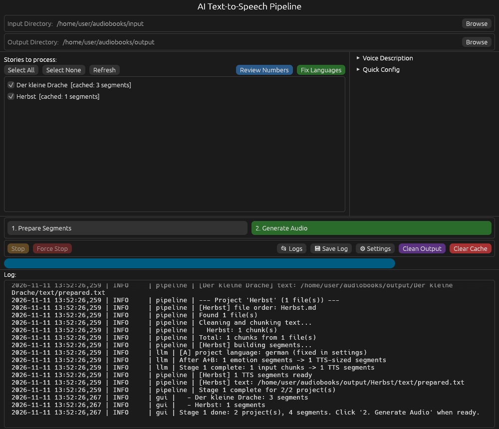
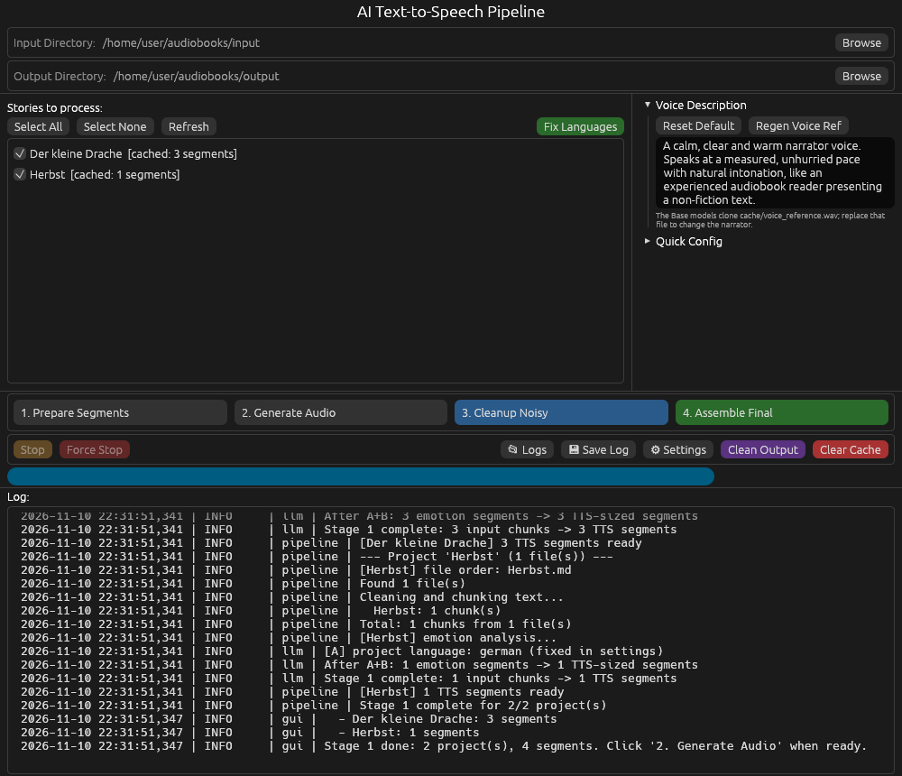
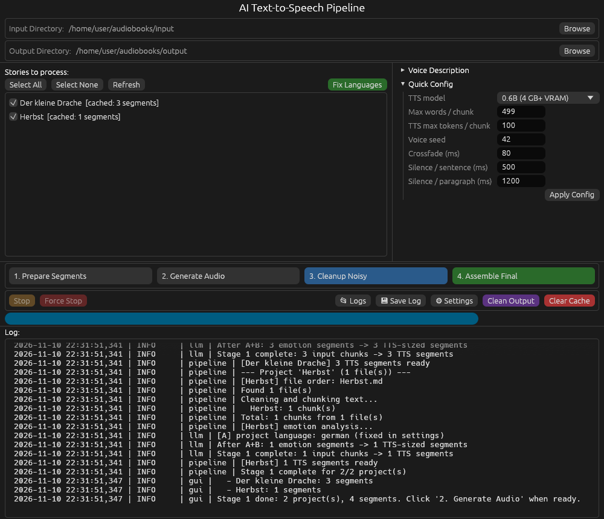
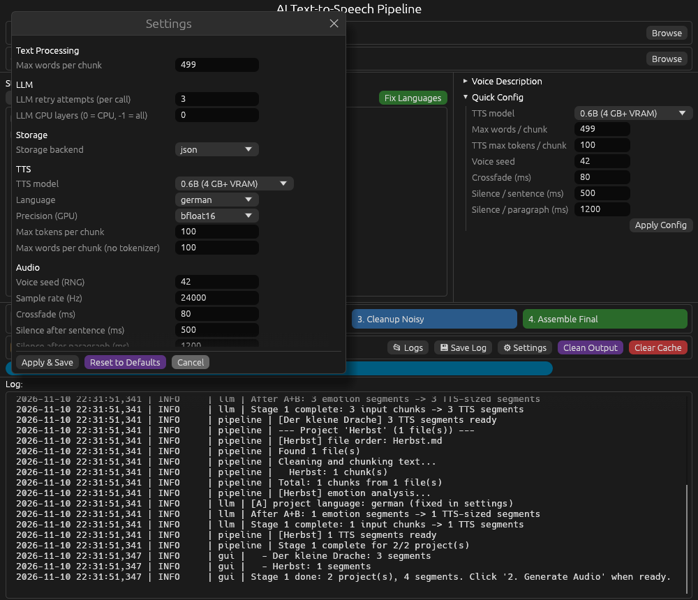

<p align="center"></p>

# text-to-audiobook - Advanced Text-to-Speech Application

> **Fork:** angepasst für deutsche Texte, Absatzpausen und GPUs mit 4 GB VRAM. Details und Installationshinweise: [FORK_DE.md](FORK_DE.md)
>
> **Rust:** This version is a reimplementation of the original Python project in Rust. Settings, cache layout and output structure stay compatible. See [Differences from the Python version](#differences-from-the-python-version).

An open-source text-to-speech application that turns Markdown texts into audiobooks. It combines the Qwen3-TTS model (voice cloning) with rule-based text preparation, optionally assisted by a small LLM (Llama 3.2 1B), and ships as a single native binary with a desktop GUI and a command-line interface.

## ✨ Features

- 🎤 **Qwen3-TTS voice cloning** on [Candle](https://github.com/huggingface/candle) (CPU, CUDA or Metal), consistent narrator via voice anchoring
- 🔢 **Number normalization** for German (optional): numbers, years, dates, ordinals, times, money, units, Roman numerals after "Kapitel"/"Teil"/… and abbreviations are spelled out before synthesis
- ✅ **Guided number review** (optional): spots the rules cannot decide (ordinals without clear context, Roman numerals like "Heinrich IV.") are listed with suggested readings to click through; a spot can also be kept as written or removed from the spoken text
- 🧠 **Optional LLM** (Llama 3.2 1B through [llama.cpp](https://github.com/ggml-org/llama.cpp)): emotion spans, language, chapter and story titles, reading order of chapter files. Without it, titles come from headings and the reading order from file names
- 🎨 **Desktop GUI** (egui) with project list, progress/ETA and live log, plus a **CLI** for headless use and Docker
- ⚡ **Audio pipeline**: Butterworth clean-up filters, crossfades, sentence/paragraph pauses, WAV + MP3 export (LAME built in, no ffmpeg needed)
- 🎧 **Provisional audiobook**: while Stage 2 runs, `final/audiobook_preview.mp3` is rebuilt in the background after every chunk, so the book can be heard before it is finished
- 🔍 **Quality audit** of generated chunks (speech ratio, loudness, clipping, MFCC voice match) with automatic regeneration
- 💾 **SQLite or JSON** cache; interrupted runs resume where they stopped
- 📊 **Tests without models**: mock backends cover the whole pipeline (`cargo test`)

## 📸 Screenshots

### Main Interface



Input and output directories, the stories (projects) found in the input directory, the two stage buttons, progress and the live log.

### Voice



Where the narrator voice (`cache/voice_reference.wav`) comes from: your own **recording**, a
**description** spoken by the Qwen3-TTS 1.7B VoiceDesign model, or a **random** voice of the
Base model (depends on the voice seed). The Base models (0.6B and 1.7B) only clone the
reference; the description needs the separate VoiceDesign model, which is loaded just once to
make the reference. After a voice change, Stage 2 speaks the chunks again.

### Quick Config



TTS model, chunk sizes, voice seed, crossfade and pauses at a glance.

### Settings Window



All settings, stored in `settings.json`.

## System Requirements

- **GPU** (optional): NVIDIA GPU with CUDA or Apple Silicon (Metal). Guide values from the Python version: 4 GB VRAM for the 0.6B model, 6 GB+ for 1.7B
- **CPU**: quad-core or better (CPU-only works, but synthesis is slow)
- **RAM**: 16 GB recommended (8 GB with the 0.6B model)
- **Disk**: 10 GB free for models and output
- **OS**: Windows 10/11, Linux, macOS 12+

### Build requirements

Only needed to build from source; the [installation packages](#installation-packages) need none of this.

- Rust 1.95 or newer ([rustup](https://rustup.rs/))
- CMake and a C/C++ compiler (llama.cpp, LAME and SQLite are compiled from source)
- Linux: Perl and make (OpenSSL is compiled in, so the binary does not depend on the system's libssl)
- For `--features cuda`: CUDA toolkit (nvcc) matching your driver
- Linux GUI at runtime: X11 or Wayland with `libxkbcommon` and OpenGL/Vulkan drivers (no GTK needed)

## Installation

### Installation packages

The [releases](https://github.com/brln-devlabs/text-to-audiobook/releases) have ready-made packages that need nothing else installed (no Rust, Python, ffmpeg or Visual C++ runtime):

| System | File | Install |
|---|---|---|
| Windows 10/11 | `text-to-audiobook-<version>-windows-setup.exe` | double-click; no administrator rights needed (installs to `%LOCALAPPDATA%\Programs`). The installer is not signed: SmartScreen asks once, "More info" → "Run anyway" |
| Windows, without installing | `text-to-audiobook-<version>-windows-portable.zip` | unpack, start `text-to-audiobook.exe` |
| Ubuntu, Debian, Linux Mint | `text-to-audiobook_<version>-1_amd64.deb` | double-click (software centre) or `sudo apt install ./text-to-audiobook_*.deb`; adds a start menu entry |
| other Linux (glibc 2.35+) | `text-to-audiobook-<version>-x86_64.AppImage` | allow "run as program" in the file properties (or `chmod +x`), double-click. The start menu entry is added on the first start |
| macOS | `text-to-audiobook-macos` | `chmod +x`, start in a terminal |

All packages compute on the CPU (macOS: Metal). The first start offers to download the speech model (once, several GB, see [Models](#hugging-face-token-optional)); texts, audiobooks and settings go to `Documents/text-to-audiobook` (see [Usage](#usage)).

What the packages contain, and what not:

- OpenSSL (Linux) and the C/C++ runtime (Windows) are linked statically; llama.cpp is built without OpenMP. Linux needs only libc, libstdc++ and the usual desktop libraries (X11/Wayland, `libxkbcommon`, EGL/Vulkan drivers); the `.deb` pulls in `libxkbcommon-x11-0`, the AppImage carries a copy for systems without it.
- Not included: the models (downloaded on first use) and GPU support. For NVIDIA GPUs build from source with `--features cuda`.

Building the packages yourself (the release workflow does the same):

```bash
cargo build --release --locked --features llm
cargo deb --no-build --no-strip --output dist/                       # needs cargo-deb
packaging/linux/build-appimage.sh target/release/text-to-audiobook 0.2.0 dist   # needs appimagetool
```

On Windows: `cargo build --release --locked --features llm,console-wrapper`, copy `target\release\text-to-audiobook-console.exe` to `dist\windows\text-to-audiobook.com` next to `text-to-audiobook.exe`, then `iscc /DAppVersion=0.2.0 packaging\windows\text-to-audiobook.iss` ([Inno Setup 6](https://jrsoftware.org/isinfo.php)).

### Building from source

```bash
git clone https://github.com/brln-devlabs/text-to-audiobook
cd text-to-audiobook
cargo build --release
```

The binary is `target/release/text-to-audiobook` (`.exe` on Windows).

GPU builds:

```bash
cargo build --release --features cuda      # NVIDIA: Qwen3-TTS on the GPU
cargo build --release --features llm-cuda  # NVIDIA: additionally Llama (llama.cpp) on the GPU
cargo build --release --features metal     # Apple Silicon (includes the LLM)
```

The LLM is optional and not built by default. To use it (`USE_LLM = true`), add the `llm` feature, e.g. `cargo build --release --features llm` or `--features cuda,llm`; llama.cpp then runs on the CPU.

With `llm`, `cuda` is enough for the default `LLM_GPU_LAYERS = 0`. `llm-cuda` links CUDA statically into llama.cpp and needs the static CUDA libraries (`libcudart_static.a`, `libcublas_static.a`, `libcublasLt_static.a`, `libculibos.a`) in `/usr/local/cuda`, `/opt/cuda` or the directory given in `CUDA_LIBRARY_PATH`.

Headless build without GUI (servers, Docker):

```bash
cargo build --release --no-default-features --features tts       # add ,llm for the LLM
```

### Hugging Face token (optional)

Models are downloaded automatically on first use. The GUI asks first, at the first start and before a step that needs a model not on disk yet (e.g. after switching to 1.7B), and shows the progress; an interrupted download continues where it stopped. Set `HF_TOKEN` if a download is refused:

```bash
export HF_TOKEN=hf_xxxxxxxxxxxxxxxxxxxxxx  # macOS/Linux
set HF_TOKEN=hf_xxxxxxxxxxxxxxxxxxxxxx     # Windows CMD
$env:HF_TOKEN="hf_xxxxxxxxxxxxxxxxxxxxxx"  # Windows PowerShell
```

- Llama-3.2-1B-Instruct (Q4_K_M GGUF) → `models/` (only with `USE_LLM = true`)
- Qwen3-TTS (0.6B or 1.7B Base) → Hugging Face cache (`HF_HOME`, default `~/.cache/huggingface`). Models already downloaded by the Python version are reused.

`TTS_MODEL_NAME` may also point to a local model directory.

## Usage

All paths are relative to the project root. It holds `settings.json`, `input/`, `output/`, `cache/`, `logs/` and `models/` and is, in this order:

1. `--root DIR`
2. `$TTA_ROOT`
3. the current directory, if it has a `settings.json` or an `input/` folder (as before: start the program in a project folder)
4. otherwise `Documents/text-to-audiobook` (Windows: the Documents folder; Linux: `XDG_DOCUMENTS_DIR`, e.g. `~/Dokumente`, else the home folder). Installed copies started from the start menu end up here.

Put the texts into `input/`; "Open" next to "Input Directory" in the GUI shows the folder.

### GUI

```bash
text-to-audiobook
```

Select the input and output directories, tick the stories and run the stages (the ticks are remembered in `cache/project_selection.json`; newly added stories start ticked):

1. **Prepare Segments** – clean, chunk and analyse the texts (cached); the result is written to `output/<project>/text/`
2. **Generate Audio** – synthesize every segment, optionally audit and regenerate failed chunks (`AUTO_CLEANUP`), denoise, assemble. Meanwhile `final/audiobook_preview.mp3` always holds every chunk done so far (see [Provisional audiobook](#provisional-audiobook))

The audit and the assembly without TTS remain available on the command line (`cleanup`, `assemble`).

The app icon lives in [`assets/`](assets/) and is set for the window, task bar and Dock; on Windows it is also embedded in the `.exe` (`build.rs`). GNOME and KDE take it from a desktop entry (Wayland has no window icons), which the GUI writes on start to `~/.local/share/applications/text-to-audiobook.desktop`; it launches the binary (from an AppImage: the AppImage file) in the current project folder. An own entry of that name without the line `X-TextToAudiobook-Managed=true` is left untouched; the `.deb` package brings its own entry, then none is written.

On Windows the GUI build is a Windows program: started from Explorer or the start menu it opens no console window. In a console, `text-to-audiobook run` etc. runs `text-to-audiobook.com` next to it (console programs prefer `.com` over `.exe`), which passes input, output and the exit code through.

### Command line

```bash
text-to-audiobook run                      # stage 1 + 2 for all projects
text-to-audiobook prepare -p MyBook        # stage 1 for one project
text-to-audiobook generate                 # stage 2 from the cache
text-to-audiobook cleanup                  # audit chunks only (AUTO_CLEANUP does this in generate)
text-to-audiobook assemble                 # stage 4
text-to-audiobook projects                 # list projects and cache state
text-to-audiobook fix-languages            # re-check language outliers
text-to-audiobook voice-ref                # regenerate the voice reference
text-to-audiobook normalize "Am 3. Mai 1995 um 14:30 Uhr"   # preview NORMALIZE_NUMBERS
text-to-audiobook review                   # decide uncertain number spots (REVIEW_NUMBERS)
text-to-audiobook --mock-models run        # dry run without models (silence)
```

`--input`, `--output` and `--project` (repeatable) work with every command; `--help` lists everything.

## Input Format

Every subfolder of `input/` is one project (book), every loose `.md` file is a project of its own. Inside a folder, the reading order follows numeric prefixes (`0_Prologue.md`, `10_Chapter.md`). Otherwise names are sorted naturally with number words recognised (`Chapter_Two` after `Chapter_One`, `Kapitel_drei`), front matter (prologue, Vorwort, Einleitung, …) first and back matter (epilogue, Nachwort, Anhang, …) last; with `USE_LLM = true` the LLM decides from names and content. The first heading of each file becomes its chapter title, the project name the story title. Supported Markdown:

- Headers (`#`, `##`, etc.) — the first one of a file is the chapter title (spoken only with `VOCALIZE_CHAPTER_NAMES`); every further one is read as a paragraph of its own (`SPEAK_HEADINGS`, on by default)
- **Bold**, *italic*, `inline code` — formatting removed, text preserved
- Links `[text](url)` — link text preserved, URL removed
- Code fences (` ``` `) — stripped entirely
- Paragraphs (separated by blank lines) — preserved; each ends with the paragraph pause

## Output Structure

```
output/
└── <project>/
    ├── final/
    │   ├── audiobook.mp3          # final audio (or chapter_01.mp3, ...)
    │   ├── audiobook.wav          # WAV mirror
    │   └── audiobook_preview.mp3  # provisional audiobook, only while Stage 2 is unfinished
    ├── text/
    │   ├── prepared.txt           # prepared text, one line per chunk ("000012 | ...")
    │   └── spoken.txt             # as spoken (with NORMALIZE_NUMBERS and review decisions)
    └── chunks/
        ├── chunk_000000.wav
        ├── chunk_000001_0.wav     # long segments are split into sub-parts
        ├── chunk_000001_1.wav
        └── ...
```

## Configuration

Edit `settings.json` in the project root or use the settings window. Keys and defaults:

| Key | Default | Meaning |
|---|---|---|
| `MAX_WORDS_PER_CHUNK` | 499 | words per text chunk (chunks never cross paragraphs) |
| `TTS_MODEL_NAME` | `Qwen/Qwen3-TTS-12Hz-0.6B-Base` | Base model id or local directory |
| `TTS_LANGUAGE` | `german` | fixed TTS language; `auto` = per-segment detection (LLM, or Qwen3-TTS itself without LLM) |
| `TTS_DTYPE` | `bfloat16` | GPU precision (`bfloat16` falls back to `float16`), CPU always float32 |
| `TTS_MAX_TOKENS` | 100 | token limit per TTS call; longer segments become sub-parts |
| `TTS_MAX_WORDS_FALLBACK` | 100 | same limit in words when no tokenizer is available |
| `VOICE_SEED` | 42 | sampling seed (same seed → same voice and output) |
| `SAMPLE_RATE` | 24000 | sample rate of mock/silence output |
| `CROSSFADE_MS` | 80 | crossfade between chunks |
| `SILENCE_AFTER_PERIOD_MS` | 500 | pause after a segment |
| `SILENCE_AFTER_PARAGRAPH_MS` | 1200 | pause after a paragraph |
| `LOUDNESS_TARGET_LUFS` | -16 | loudness of the finished file (EBU R128, pauses gated out), peaks limited to -1.5 dBFS; `0` = keep the synthesized level |
| `NORMALIZE_NUMBERS` | false | spell out numbers, dates, times, units, abbreviations (German segments) |
| `AUTO_CLEANUP` | false | after synthesis audit every chunk, delete failed ones and synthesize them again with another seed (2 rounds, the last attempt is kept) |
| `REVIEW_NUMBERS` | false | guided review of spots the rules cannot decide (ordinals without clear context, Roman numerals); needs `NORMALIZE_NUMBERS` |
| `USE_LLM` | false | use Llama in stage 1 (emotion spans, titles, file order, `auto` language); needs the `llm` feature |
| `LLM_GPU_LAYERS` | 0 | Llama layers on the GPU (0 = CPU, -1 = all) |
| `LLM_MAX_RETRIES` | 3 | attempts per LLM call |
| `STORAGE_BACKEND` | `json` | `json` or `sqlite` |
| `CHAPTER_BY_CHAPTER` | false | one MP3 per source file |
| `VOCALIZE_CHAPTER_NAMES` | false | speak the chapter name (first heading, else the file name) first |
| `SPEAK_HEADINGS` | true | speak every heading after a file's first one as a paragraph of its own (the first one is the chapter name) |
| `LOG_LEVEL_CONSOLE` / `LOG_LEVEL_FILE` | `INFO` / `DEBUG` | log levels |
| `VOICE_SOURCE` | `random` | narrator voice: `file` (recording), `design` (from the description), `random` |
| `VOICE_REFERENCE_FILE` | – | recording for `VOICE_SOURCE = "file"` (WAV, 10–15 s) |
| `NARRATOR_PROMPT` | calm narrator | voice description for `VOICE_SOURCE = "design"` |
| `VOICE_DESIGN_MODEL` | `Qwen/Qwen3-TTS-12Hz-1.7B-VoiceDesign` | model that turns the description into a voice |

## Testing

```bash
cargo test
```

The tests use mock LLM/TTS backends and temporary directories: no models, GPU or network needed. They cover Markdown cleaning, chunking, storage backends, LLM answer validation, voice anchoring and sub-part handling, filters (checked against scipy), MFCC (checked against librosa), crossfade timing (checked against pydub), the quality audit and an end-to-end run.

```bash
cargo fmt --check
cargo clippy --all-targets
```

## Architecture

| Module | Role |
|---|---|
| `markdown_cleaner`, `chunker` | Markdown → plain text → paragraph-aligned chunks |
| `llm` | optional Llama 3.2 via llama.cpp (`llama-cpp-2`), JSON-only prompts with validation and retries; rule-based fallbacks |
| `normalize_de` | German number/date/unit/abbreviation normalization |
| `storage` | JSON or SQLite cache per project |
| `tts` | Qwen3-TTS via Candle (`qwen_tts`), voice anchoring, sub-parts, ID3 tags |
| `audio` | WAV I/O, Butterworth filters, assembler (WAV + MP3), quality audit, MFCC |
| `pipeline` | stages 1–4, project discovery, chapter assembly |
| `preview` | provisional audiobook while Stage 2 runs (background thread) |
| `gui`, `main` | egui desktop app and CLI |
| `desktop_entry` | Linux: desktop entry and icon, so GNOME/KDE show the app icon |

### Stage 1: Text preparation
1. Discover projects → order files → clean Markdown → split into paragraph-aligned chunks
2. Story title from the project name, chapter titles from the first heading of each file
3. Segments are cached; interrupted runs resume

With `USE_LLM = true`, **Llama-3.2-1B-Instruct** (4-bit GGUF) additionally orders files by content, votes on the project language (`TTS_LANGUAGE = auto`), splits chunks into emotion spans by sentence number (it returns only index ranges, so it cannot alter the text) and looks for story and chapter titles. Qwen3-TTS Base models take no emotion input, so the emotion spans only change where segments are cut.

### Stage 2: Audio generation
1. Load **Qwen3-TTS** (0.6B or 1.7B Base); create `cache/voice_reference.wav` if missing
2. With `NORMALIZE_NUMBERS`, German text gets numbers, dates and abbreviations spelled out; decisions from the number review (`cache/<project>/review.json`) are applied first
3. Chunk 0 clones the voice reference → becomes the **anchor**
4. Every later chunk clones the anchor (x-vector voice cloning), same seed each time
5. Denoise each chunk (high-pass 60 Hz, low-pass 9 kHz)
6. Join with crossfades and pauses, export WAV + MP3

### Provisional audiobook
After every newly spoken chunk a second thread rebuilds `final/audiobook_preview.mp3` from all chunks done so far, while the TTS goes on with the next chunk. It is mixed like the final file (denoise filters applied in memory, crossfades, pauses, loudness) but always as one file, also with `CHAPTER_BY_CHAPTER`, and without a WAV mirror. One build runs at a time; chunks that finish during a build go into the next one, so on long books the preview may lag a few chunks behind, but it never holds up the synthesis (a build of a 1-hour book takes about half a minute on one CPU core). The file is written under `audiobook_preview.mp3.part` and then renamed, so a player never gets a half-written file; on Windows a player that keeps the file open can block the update (one warning in the log, the next chunk tries again).

When Stage 2 is stopped (Stop) or fails, the preview is brought up to date with every chunk done; Force Stop leaves it as it is. Chunks that are only reused trigger no rebuild. Once the final files are assembled (Stage 2 or `assemble`), the preview is deleted.

### Voice Anchoring
The narrator voice is locked after the first chunk. Every following chunk uses that audio as voice reference, which keeps the speaker identity stable across the whole book. For your own narrator, choose a 10–15 s recording in the Voice panel (`VOICE_SOURCE = "file"`, see [FORK_DE.md](FORK_DE.md)).

## Differences from the Python version

- **One binary**, no Python, PyTorch or ffmpeg installation. Models: llama.cpp for Llama (same GGUF file), Candle for Qwen3-TTS (same Hugging Face checkpoints, shared cache).
- **LLM optional and off by default** (`USE_LLM`): titles from headings and the project name, reading order from file names. To get the Python behaviour back, build with `--features llm` and set `USE_LLM = true`.
- **Number normalization** (`NORMALIZE_NUMBERS`, German) is new; the Python version's LLM-based normalization was disabled.
- **CLI and Docker** run the pipeline headless; the GUI is optional (feature `gui`).
- **Chapter order:** stage 2 and stage 4 number and join chapters in reading order. The Python version sorted chapters alphabetically, so `10_…` came before `2_…`.
- **Two stage buttons:** "Prepare Segments" and "Generate Audio"; the audit runs inside "Generate Audio" when `AUTO_CLEANUP` is on and regenerates failed chunks with a new seed (the same seed would give the same result).
- **Progress bar:** during "Generate Audio" the bar first shows only the synthesis, weighted by text length (a long chunk split into sub-parts counts for more). The ETA is based only on the chunks spoken in this run, so the reused chunks of an interrupted run do not make it too short. Then the bar starts again from 0 for the post-processing of each project (audit, denoising, assembly).
- **Voice-match check is active:** the MFCC check of the audit needed librosa, which was not a dependency, so the Python version skipped it. The Rust version computes the same MFCCs natively.
- **ID3 tags** are stored in the WAV's RIFF `ID3 ` chunk and survive denoising and cleanup; the Python version prepended them to the file, and the next denoise removed them.
- **Long books** are assembled in a streaming fashion (constant memory instead of repeated in-memory copies).
- **Force Stop** stops at the next possible point (between sub-parts and model calls) and removes the partial chunk; a single model call that is already running finishes first.
- **MP3 bitrate:** 192 kbit/s at 32 kHz and above; at 24 kHz the MPEG-2 maximum of 160 kbit/s applies.
- **Small fixes:** duplicate file names in the LLM's reading order are ignored; cache entries are listed in numeric order beyond 9999 segments; WAVs written by the Python version (also with a leading ID3 tag) are read as they are.
- The Qwen3-TTS implementation is the community crate [`qwen_tts`](https://crates.io/crates/qwen_tts). Its sampling uses a PyTorch-compatible RNG, but output is not bit-identical to the PyTorch reference.

## Logging

Logs go to the console, the GUI and `logs/pipeline.log` (rotating, 5 MB per file, 5 backups).

Format: `YYYY-MM-DD HH:MM:SS,mmm | LEVEL | module | message`

## Troubleshooting

| Issue | Solution |
|---|---|
| Model download fails | Set `HF_TOKEN`; check the network/proxy (`HTTPS_PROXY` is honoured) |
| Build fails in `llama-cpp-sys-2` or `mp3lame-sys` | Install CMake and a C/C++ compiler |
| `could not find native static library cudart_static` | Build with `--features cuda` (Llama stays on the CPU); for `llm-cuda` set `CUDA_LIBRARY_PATH` to the directory with the static CUDA libraries |
| `CUDA out of memory` | Use the 0.6B model, keep `LLM_GPU_LAYERS = 0`, close other GPU programs |
| GUI does not start on Linux (`xkbcommon`) | Install `libxkbcommon-x11-0` (Debian/Ubuntu) and GPU/OpenGL drivers |
| AppImage does not start ("FUSE") | start it with `--appimage-extract-and-run`, or install FUSE (`sudo apt install fuse3`) |
| Windows: no output in the console | type `text-to-audiobook` without `.exe` (runs `text-to-audiobook.com`), or call the `.com` directly |
| Voice inconsistency between chunks | Check `cache/voice_reference.wav`; after changing the model, delete `output/<project>/chunks` (a new voice is picked up automatically) |
| Want to test without models | `text-to-audiobook --mock-models run` |

## References

- **Llama 3.2**: [Meta Model Card](https://huggingface.co/meta-llama/Llama-3.2-1B-Instruct)
- **llama.cpp**: [ggml-org/llama.cpp](https://github.com/ggml-org/llama.cpp), Rust bindings [llama-cpp-2](https://github.com/utilityai/llama-cpp-rs)
- **Qwen3-TTS**: [Qwen on Hugging Face](https://huggingface.co/Qwen), Candle port [qwen3-tts-rs](https://github.com/danielclough/qwen3-tts-rs)
- **Candle**: [huggingface/candle](https://github.com/huggingface/candle)
- **egui**: [emilk/egui](https://github.com/emilk/egui)

## Continuous Integration & Deployment

| Workflow | Trigger | Purpose |
| --- | --- | --- |
| Tests | Push to main/master/develop, PRs | `cargo test --no-default-features` on Linux (no GUI or model backends) and a CLI dry run |
| Code Quality | Push to main/master/develop, PRs | `cargo fmt --check`, `cargo clippy` |
| Build & Release | Git tags (v*), manual trigger | Windows installer and portable ZIP, Linux `.deb` and AppImage (built on Ubuntu 22.04), macOS binary; checks the run-time dependencies and makes a dry run of each package |
| Docker Build | Tags, main branch, manual | build and push the headless Docker image |

### Docker

The image contains the headless binary (no GUI). Mount the project root at `/app`:

```bash
docker compose run --rm ai-tts run
docker compose run --rm ai-tts generate -p MyBook
```

## License

This project is licensed under the **GNU Affero General Public License v3.0 (AGPL-3.0)**, a copyleft open-source license ensuring freedom and transparency:

- ✅ Commercial use allowed
- ✅ Modifications allowed
- ✅ Distribution allowed
- ⚠️ Modifications must be shared under AGPL
- ⚠️ Network deployments require source code access

Dependencies & Models:

- Rust dependencies use permissive licenses (MIT, Apache 2.0, BSD, Zlib); the bundled LAME MP3 encoder is LGPL
- Qwen3-TTS: Apache 2.0
- Llama-3.2: Meta Community License Agreement

See [LICENSE](LICENSE) for full AGPL-3.0 text and [License notice](docs/LICENSES_NOTICES.md) for dependency and model license documentation.
